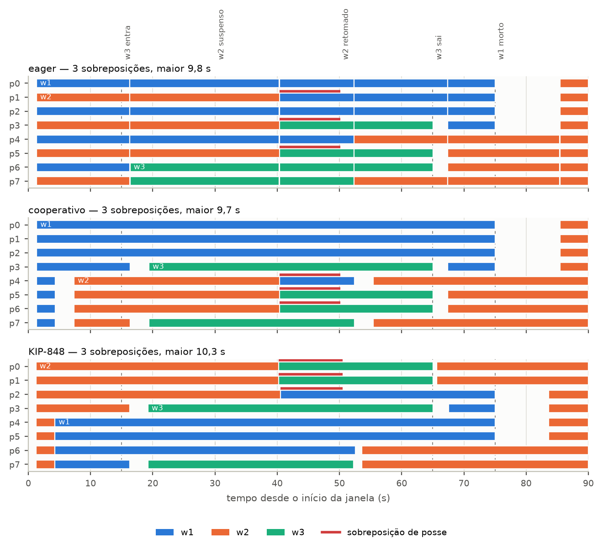

# Corretude e disponibilidade no rebalanceamento de grupos de consumidores do Apache Kafka

Trabalho de Conclusão de Curso, Ciência da Computação, PUCRS, 2026/2.
Guilherme Hoffmann Batistti dos Santos. Orientador: Prof. Dr. Fernando Luís Dotti.

## Problema

O Apache Kafka divide cada tópico em partições e as distribui entre os consumidores de um
grupo, de modo que cada partição tenha um único responsável. Quando um consumidor entra
ou sai, o grupo faz um rebalanceamento. Três protocolos de rebalanceamento coexistem no
mesmo broker: eager, cooperativo (KIP-429) e KIP-848.

A métrica usada para compará-los, tempo de rebalanceamento, não designa a mesma grandeza
nos três: no eager é uma pausa global do grupo, no cooperativo pode abranger várias
rodadas, e no KIP-848 não existe um evento global a cronometrar. Ela também nada diz sobre
corretude. O Kafka protege a confirmação da posição de leitura com épocas, mas não impede
que um consumidor excluído do grupo, sem saber que foi excluído, continue processando
registros de uma partição que já pertence a outro.

## Abordagem

O problema é descrito como comunicação em grupo com sincronia de visão, sem referência ao
Kafka. Sobre essa descrição são definidas duas grandezas que valem igualmente para os
três protocolos, calculadas a partir de um histórico de intervalos de posse
`(trabalhador, partição, época, início, fim)`:

- **sobreposição de posse**: o tempo em que dois trabalhadores distintos se consideram
  responsáveis pela mesma partição, que é uma violação de exclusividade;
- **tempo órfão**: o tempo em que uma partição fica sem nenhum responsável.

Um consumidor Java instrumentado registra os callbacks de `ConsumerRebalanceListener`, um
orquestrador aplica ao grupo uma sequência temporizada de entradas, saídas, mortes e
suspensões de consumidores, e um verificador independente do Kafka calcula as duas
grandezas sobre o histórico resultante.

O modelo, as definições e a verificação delas no código do cliente Java estão em
[notas/formalizacao.md](notas/formalizacao.md).

## Resultados preliminares

Broker Kafka 4.3.2, oito partições, sessão de 10 s, sinal de vida de 3 s, sem carga de
processamento. O traço piloto suspende um consumidor por 20 s, acima do tempo de sessão.
Cinco execuções por protocolo; mediana e, entre colchetes, mínimo e máximo.

| Protocolo | Sobreposições por execução | Maior sobreposição (s) | Tempo órfão total (s) |
|---|---|---|---|
| eager | 3 em todas | 9,78 [9,35; 9,89] | 59,4 [57,9; 66,1] |
| cooperativo | 3 em todas | 9,91 [9,89; 9,96] | 80,5 [68,5; 81,3] |
| KIP-848 | 3 em todas | 10,26 [9,97; 10,37] | 77,9 [65,8; 83,0] |

- Os três protocolos violam a exclusividade de posse sob suspensão, com a mesma grandeza.
  O consumidor suspenso é excluído quando a sessão expira, suas partições passam a outros,
  e ele só descobre a perda no primeiro `poll()` depois de retomado. A duração da
  violação é fixada pelo tempo de sessão, não pelo protocolo.
- O tempo órfão foi maior nos protocolos incrementais. Sem carga, a barreira do eager
  custa dezenas de milissegundos, enquanto cada transferência incremental espera um ciclo
  de sinal de vida. A hipótese de que reduzir a sincronização global reduz o tempo órfão
  não se confirmou nestas condições; carga e intervalo do sinal de vida são as variáveis
  da próxima etapa.



Detalhes, limitações e a tabela completa em
[notas/resultados-piloto.md](notas/resultados-piloto.md).

## Conteúdo

```
notas/          formalização do modelo e resultados do piloto
experimento/    broker, coletor, orquestrador, verificador, traços e execuções gravadas
volume-1/       referências e figuras do volume de TCC I
proposta/       proposta entregue e devolução comentada pelo orientador
explicacao/     página interativa com animações do modelo, dos protocolos e do verificador
```

A página em [explicacao/posse-de-particoes.html](explicacao/posse-de-particoes.html)
mostra, passo a passo, a posse de partições sob suspensão de um consumidor, o mesmo
rebalanceamento nos três protocolos e a varredura do verificador. Basta abrir o arquivo no
navegador.

Para reproduzir os experimentos ou reprocessar as execuções gravadas, ver
[experimento/README.md](experimento/README.md). Requer Docker, Java 17 ou superior e
[uv](https://docs.astral.sh/uv/).

## Situação

TCC I, em andamento: formalização, ambiente experimental, verificador e pilotos
concluídos; volume em redação, com entrega em 30/11/2026. TCC II, em 2027/1: campanha
experimental com carga de processamento e variação do sinal de vida, separação entre
protocolo e estratégia de atribuição, caracterização de pior caso e verificação formal do
modelo.
